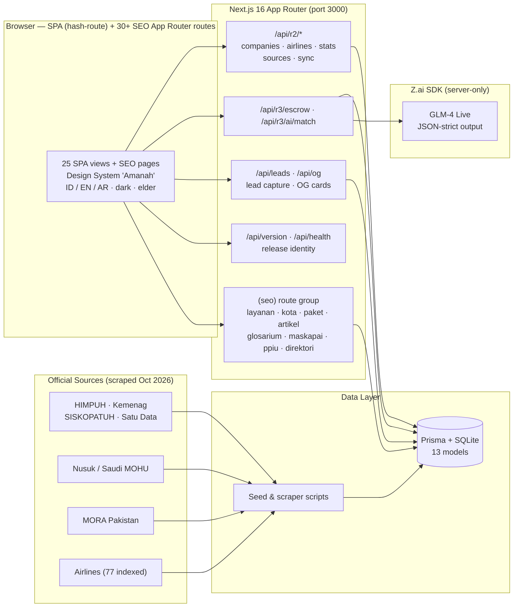
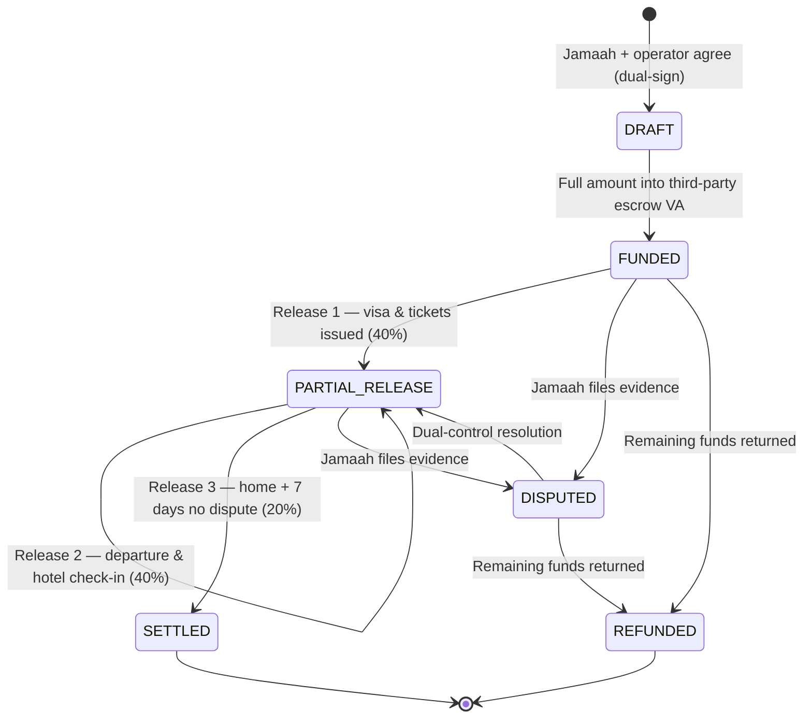
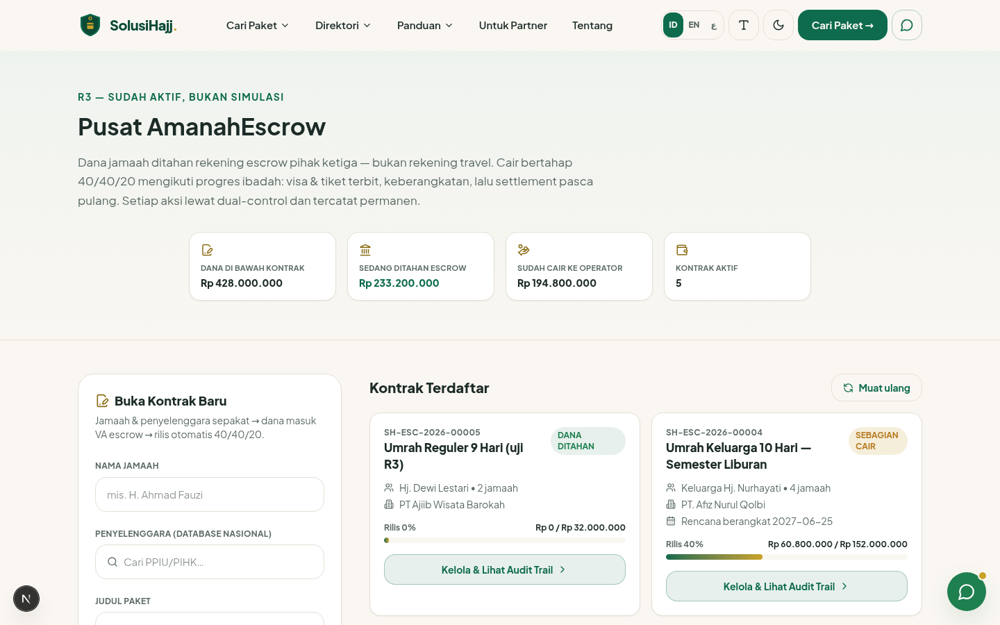
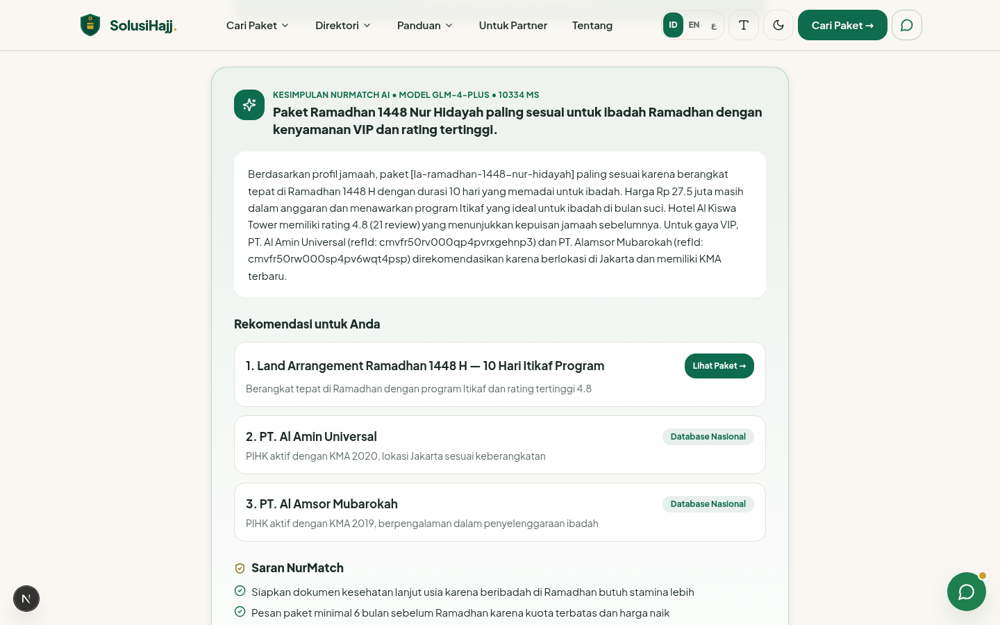
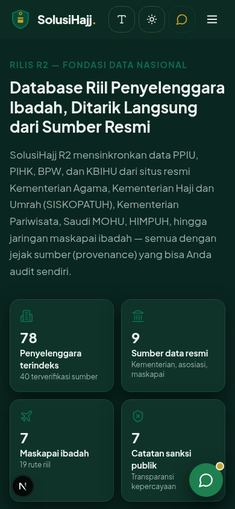
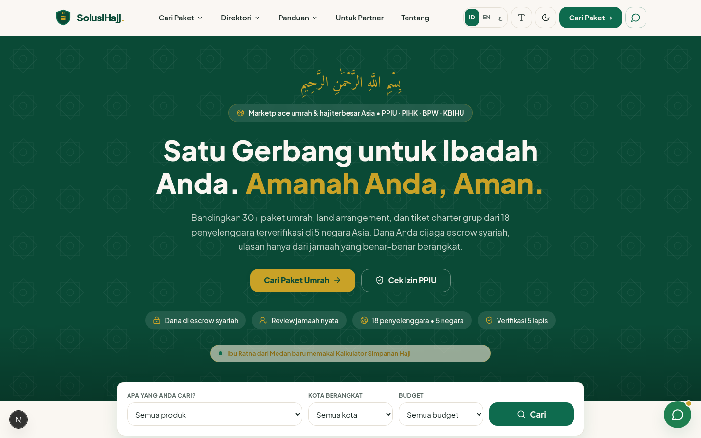

<div align="center">

# SolusiHajj

### The World's Largest Hajj & Umrah Marketplace — "Amanah Anda, Aman."

**One gateway for every licensed Umrah & Hajj operator in Asia. Packages from real operators.
Money guarded by escrow. Trust verified in five layers. AI that explains itself.**

[](CHANGELOG.md)
[](CHANGELOG.md)
[](https://semver.org)
[](public/humans.txt)
[](https://nextjs.org)
[](https://www.typescriptlang.org)
[](https://www.prisma.io)
[](https://tailwindcss.com)
[](https://ui.shadcn.com)
[](https://z.ai)
[](https://peraturan.bpk.go.id)

**[Readme Bahasa Indonesia](README_ID.md) — versi Indonesia tersedia**

</div>

---

## ⚡ Release Snapshot — SolusiHajj v2.1.0 "Sinyal Global" (2026-10-22)

v2.1.0 ships **Prioritas 5 — the discovery & distribution engine**: `llms.txt` for LLM
crawlers, canonical RSS, hreflang id/en via next-intl, the `/bandingkan` compare page,
and a 720-page faceted catalog — pushing the sitemap to **14,714 URLs**. Governance is
now enforced by a **CI Release Gate** (pre-commit hook rejects version drift).
v2.0.0 activated the **SolusiHajj Release System**: every command and every change in
this repository carries a version number (SemVer) — see [CHANGELOG.md](CHANGELOG.md)
and [WORKLOG.md](WORKLOG.md).

| Version | Codename | Headline |
|---|---|---|
| **v2.1.0** | Sinyal Global | `llms.txt` · canonical RSS `/feed.xml` · hreflang id/en (10 `/en` pages, next-intl) · `/bandingkan` compare page · 720-page faceted catalog `/katalog` · CI Release Gate · admin release badge · sitemap 13,984 → **14,714** |
| **v2.0.0** | Nexus Governance | Release system activated — VERSION file, CHANGELOG, versioned WORKLOG, `/api/version`, footer release stamp, git tag |
| **v1.5.0** | Kelas Dunia | Header & navigation redesigned to global consulting-firm standard (utility trust bar, mega menu, app-grade mobile drawer) |
| **v1.4.0** | Mesin Konten | Article Content Engine 4 → **112 articles** (±90,000 words, 8 categories, 3-layer silo) + permanent hydration-mismatch fix |
| **v1.3.0** | Kartu Dinamis | Dynamic OG image cards for **all 13,984 pages** (price/rating/badge) + image sitemap (13,831 images) |
| **v1.2.0** | Matrix 9.450 | **9,450 programmatic-SEO pages** (210 services × 45 cities, ISR) + lead-capture engine (`ServiceLead`, ref-numbered) |
| **v1.1.x** | Gerbang SEO | SEO App Router foundation — 210 services, 45 cities, legal pages, sitemap 4,418 URLs, full JSON-LD stack |
| **v1.0.0** | Fondasi Amanah | SolusiHajj R3 installed & verified — escrow state machine, NurMatch AI, 3,966-organization national database |

Check the running release anytime:

```bash
curl http://localhost:3000/api/version
# { "version": "2.1.0", "label": "SolusiHajj v2.1.0", "codename": "Sinyal Global", ... }
```

---

## Why SolusiHajj Exists

Every year, millions of Indonesian and Asian pilgrims hand over **their life savings** to Umrah operators —
often after seeing nothing but an Instagram post. Frauds, vanished operators, hotel bait-and-switch:
the industry's trust deficit is measured in billions of rupiah and broken promises.

SolusiHajj is the answer: a **pure marketplace** (a *wadah*) that aggregates every licensed operator —
**PPIU, PIHK, BPW, KBIHU** across Asia — under one trust-first platform. The platform never sells its own
packages. Operators supply the packages; SolusiHajj supplies **verification, escrow, transparency, and reach**.

| Pillar | What it means |
|---|---|
| **Marketplace Engine** | 27 packages, 10 group charter flights, city filters, monthly price calendar, side-by-side compare |
| **Trust & Syariah** | Verifikasi 5 Lapis, AmanahEscrow 40/40/20 with dual-control, Saksi Jamaah review-gated ratings, public sanctions register |
| **Real Data** | **3,966 organizations** indexed from 9+ official government/association sources — every row has provenance |
| **Programmatic SEO** | **13,984 URLs** in one sitemap: service pages, city landings, 9,450-page service×city matrix, 112-article content hub |
| **NurMatch AI** | A live LLM advisor that recommends only from real catalog + database candidates, and shows its reasoning |
| **Asia-Wide Directory** | Indonesia, Saudi Arabia (Nusuk/MOHU), Pakistan (MORA), Malaysia, Singapore, Brunei, Thailand |
| **Radical Accessibility** | Elder mode (17 → 19.5 px), dark "Malam Madinah" mode, ID/EN/AR, 48 px touch targets, consulting-grade header |

---

## The Numbers (verified live — October 2026)

| Metric | Value | Source |
|---|---|---|
| Sitemap URLs | **14,714** | Live `sitemap.xml` (1 file, < 50 MB) |
| ─ Programmatic matrix (service × city) | 9,450 | `/layanan/[slug]/dari-[kota]`, ISR 24 h |
| ─ Directory (DB-backed profiles) | 3,966 | Live SQLite, provenance-audited |
| ─ Faceted catalog (v2.1.0) | 720 | `/katalog` — 5 types + 335 cities + 31 provinces + 53 prov×type + 293 city×type |
| ─ Articles + category hubs | 112 + 8 | E-E-A-T content engine, 8 categories |
| ─ English pages (hreflang id/en) | 10 | `/en`, `/en/services`, `/en/packages`, … (next-intl) |
| ─ Services / cities / packages / glossary / airlines / PPIU | 225 / 46 / 28 / 35 / 77 / 19 | Static SEO routes |
| OG image cards (1200×630, dynamic) | **14,500+** | Image sitemap extensions |
| hreflang alternate links in sitemap | 60 | `id` / `en` / `x-default` per paired page |
| RSS feed | `/feed.xml` (50 latest) | `/api/rss` → 308 redirect |
| llms.txt manifest | `/llms.txt` | LLM-crawler discovery per llms.txt convention |
| Organizations in database | **3,966** | 2,670 PPIU · 1,019 PIHK · 228 UTO · 47 USP · 2 BPW |
| Verified organizations | 3,619 | Status AKTIF/TERDAFTAR |
| Lead capture | `ServiceLead` + ref `SH-LEAD-YYYY-XXXXX` | Rate-limited, honeypot, page-path attribution |
| JSON-LD types | 12+ | Organization, Service+Offer, FAQPage, Article, ItemList, Dataset, HowTo… |
| UI views | 25 | Single hash-route SPA + 40+ App Router SEO routes |

---

## Release Ladder

| Release | Version | Codename | Status | Headline |
|---|---|---|---|---|
| **R1** | — | Gerbang Kepercayaan | DONE | Trust-first homepage, 24-package catalog, public "Cek Izin PPIU" tool, hajj savings calculator |
| **R1.5** | — | Marketplace Asia Superapp | DONE | 5-country directory, compare tray, 29 JSON-LD blocks, dark + elder modes, ID/EN/AR |
| **R2** | — | Fondasi Data Nasional | DONE | Real national database from 9 official sources, airlines module, live sync pipeline |
| **R3** | **v1.0.0 → v1.5.0** | AmanahEscrow + NurMatch + SEO Matrix | **THIS RELEASE** | Escrow state machine, live LLM advisor, 13,984-URL SEO engine, 112-article hub, consulting-grade header |
| **R4** | v3.x (planned) | Production Hardening | Next | Bank VA integration, KYC, operator dashboards, multi-region deployment |

---

## Architecture



### Data Provenance — every row knows where it came from

```
HIMPUH (474) ──► 19 list pages ──► 474 detail pages ──► parse jenis/registrasi/phone/email/web
Nusuk   (47) ──► provider cards ──► 47 profile pages (city, phone, CF-decoded email, about)
MORA PK (228)──► official document table ──► 344 rows ──► 228 company-like names
                                    │
                                    ▼
                    normalize(name) dedup-index ──► merge or create Company (3,966 rows)
                                    │
                                    ▼
              DataSource.recordsIndexed++  ·  SyncEvent(SUCCESS, note)  ──► audit trail
```

### AmanahEscrow — the money never touches the operator first



**Dual-control:** an operator can only *request* a release; the platform approves it as a second key.
Every transition writes an immutable `EscrowEvent` — the pilgrim (Saksi Jamaah) watches everything.

### NurMatch AI — helpful, but caged

1. Server filters **real candidates**: top-10 catalog packages within 115% of budget + 8 verified operators from the national DB.
2. A strict system prompt forces **JSON-only** output, warm elder-friendly Indonesian, and forbids inventing products.
3. The LLM (GLM-4) reasons over price fit, hotel distance-to-Haram, month, and Saksi Jamaah ratings.
4. If the AI is unavailable, a **transparent deterministic scorer** takes over — the feature never dies.
5. Every session is stored (`AiMatchSession`) — recommendations are auditable, not a black box.

### Programmatic SEO engine (v1.1 → v1.4)

- **Service×City matrix** — 9,450 static pages (`/layanan/[slug]/dari-[kota]`), each with unique intro,
  airport/charter context, combined FAQ, two-way silo links, and per-combination metadata + OG card.
- **Content hub** — 112 articles in 8 categories (Panduan Umrah, Manasik & Doa, Visa & Dokumen,
  Hotel & Transportasi, Biaya & Keuangan, Keluarga & Lansia, Musim & Waktu, Keamanan & Verifikasi),
  with index → category → detail → related silo architecture.
- **Structured data everywhere** — Service+Offer, FAQPage, Article, CollectionPage, BreadcrumbList,
  Organization, ItemList, Dataset, HowTo, DefinedTerm, TravelAgency, SearchAction.
- **Dynamic OG cards** — one API route (`/api/og`) renders branded 1200×630 cards (price, rating,
  verification badge) for every page; wired into metadata + image sitemap.

---

## Quick Start

```bash
# 1. Install
bun install

# 2. Database (schema push; SQLite file at db/custom.db)
bun run db:push

# 3. (Optional) Re-seed the national directory from scraped JSON
bun scripts/seed-r2.ts && bun scripts/seed-r3.ts

# 4. Dev server — http://localhost:3000
bun run dev

# 5. Lint
bun run lint

# 6. Verify the running release
curl http://localhost:3000/api/version
```

Re-run the scrapers anytime (resumable, checkpointed):

```bash
bun scripts/fetch-himpuh-full.ts   # 19 list pages + 474 detail pages -> scripts/data/himpuh-full.json
bun scripts/fetch-asia.ts          # Nusuk 47 providers + MORA Pakistan -> scripts/data/asia-sources.json
```

---

## API Reference

| Endpoint | Method | Purpose |
|---|---|---|
| `/api/version` | GET | **Release identity** — version, label, codename, build date (SolusiHajj Release System) |
| `/api/health` | GET | Healthcheck — DB latency + **version block** + runtime |
| `/api/r2/companies` | GET | Directory search: `q, type, province, status, limit` + facets |
| `/api/r2/airlines` | GET | Airlines + real routes, `byService` filter |
| `/api/r2/stats` | GET | Aggregates: totals, by type/status/country/province |
| `/api/r2/sources` | GET | Data sources + recent sync events |
| `/api/r2/sync` | POST | Trigger a validated pipeline sync (audit-logged) |
| `/api/r3/escrow` | GET / POST | List contracts + volume / create contract (auto 40-40-20 milestones) |
| `/api/r3/escrow/[id]` | GET / POST | Full detail + audit trail / action: `FUND, RELEASE, DISPUTE, RESOLVE, REFUND` |
| `/api/r3/ai/match` | GET / POST | Recent AI sessions / profile → live LLM recommendation |
| `/api/leads` | POST / GET | **Lead capture** — public POST (rate-limited, honeypot) / admin GET |
| `/api/og` | GET | **Dynamic OG card** 1200×630 — params `t, chip, price, foot, k, rating, reviews, badge, sub` |
| `/feed.xml` | GET | **Canonical RSS 2.0** — 50 latest articles (DB → static fallback, never 500s) |
| `/api/rss` | GET | Legacy feed endpoint — **308 redirect** to `/feed.xml` |
| `/llms.txt` | GET | **LLM discovery manifest** (llms.txt convention) — curated site map for AI crawlers |

Escrow action rules enforced server-side: sequential releases only, no release before `FUNDED`,
dispute requires ≥ 10-character evidence note, refund only of unreleased remainder.

---

## Data Models (Prisma / SQLite)

`DataSource` · `SyncEvent` · `Company` (unique name+orgType, indexed) · `SanctionRecord` ·
`GovRegulation` · `Airline` · `FlightRoute` · `EscrowContract` · `EscrowMilestone` (unique contractId+seq) ·
`EscrowEvent` (append-only) · `AiMatchSession` · `ServiceLead` (unique ref, page-path attribution)

---

## Design System "Amanah"

| Token | Value |
|---|---|
| Green (primary) | `#0E6B4E` |
| Gold (accent) | `#C9A227` |
| Ivory (background) | `#FAF7F2` |
| Body font | Plus Jakarta Sans (17 px base) |
| Display/Arabic | Amiri (RTL-aware) |
| Touch targets | ≥ 48 px |
| Radius / shadows | 16 / 12 px, 3-level warm-green shadows |
| Elder mode | body 17 → 19.5 px, persistable |
| Dark mode | "Malam Madinah" palette |
| Header | CHROME R2 — consulting-grade: utility trust bar + mega menu + app-grade drawer |

---

## SolusiHajj Release System (versioning governance)

This repository is governed by the **SolusiHajj Release System** — every command and every change
must carry a version. International-standard practices:

| Artifact | Role |
|---|---|
| [`VERSION`](VERSION) | Canonical version number (root, single line) |
| [`CHANGELOG.md`](CHANGELOG.md) | Keep a Changelog 1.1.0 — every release, categorized (Added/Changed/Fixed/Verified) |
| [`WORKLOG.md`](WORKLOG.md) | Engineering task ledger — chronological, every task stamped `[vX.Y.Z]` |
| `src/lib/version.ts` | Runtime source of truth (imported by API + footer + admin badge — never hardcode versions elsewhere) |
| `/api/version` | Live release identity for post-deploy verification |
| Git tag `vX.Y.Z` | Immutable release snapshot |
| **CI Release Gate** | `githooks/pre-commit` → `scripts/verify-version-sync.mjs` — **rejects the commit** when VERSION ≠ package.json ≠ version.ts ≠ CHANGELOG. Activate on a fresh clone: `git config core.hooksPath githooks`. Manual check: `bun run verify:version` |

**Semantic Versioning policy:**

- **MAJOR** — governance/architecture overhaul or product-ladder jump (R-ladder).
- **MINOR** — new features without breaking (new pages, engines, modules).
- **PATCH** — bug fixes and hardening without new features.

**Release SOP (bump a version):**

1. Update `APP_VERSION`, `APP_CODENAME`, `APP_BUILD_DATE` in `src/lib/version.ts`.
2. Sync `VERSION` (root) and `package.json` `"version"`.
3. Add a new section at the top of `CHANGELOG.md` (Keep a Changelog format).
4. Append the task entry to `WORKLOG.md` stamped with the new version.
5. Commit — the **Release Gate hook** blocks the commit if the versions drift — then `git tag -a vX.Y.Z -m "SolusiHajj vX.Y.Z — <codename>"`.
6. Push code + tag to the remote so the release is immutable: `git push origin main --follow-tags` (remote: `github.com/prabudanling/solusihajj`).
7. Verify: `curl /api/version` returns the new version; footer stamp + admin badge update automatically.

---

## Repository Layout

```
VERSION                     # Canonical release number
CHANGELOG.md                # Keep a Changelog — release history
WORKLOG.md                  # Versioned engineering task ledger
src/
  app/
    page.tsx                # SPA shell (hash-route, 25 views)
    (seo)/                  # 40+ SEO App Router routes
      layanan/[slug]/[kota] # 9,450-page service×city matrix (ISR)
      artikel/              # 112-article hub + 8 category routes
      katalog/              # 720-page faceted catalog (types × cities × provinces)
      bandingkan/           # Package compare page (client picker + SEO table)
      kota/ paket/ glosarium/ maskapai/ ppiu/ direktori/ legal
    (en)/en/                # 10 English pages — hreflang id/en (next-intl)
    llms.txt/ feed.xml/     # LLM manifest + canonical RSS
    api/
      version/ health/      # Release identity + healthcheck
      leads/ og/ rss/       # Lead capture + OG cards + legacy feed redirect
      r2/                   # Directory, airlines, stats, sources, sync
      r3/                   # Escrow state machine + NurMatch AI
  components/
    solusihajj/             # SPA views + CHROME R2 header/footer
    seo/                    # JSON-LD, lead form, silo + compare-picker components
    admin/ views/ ui/       # Admin dashboard (release badge), views, shadcn/ui
  data/
    services/               # 210 services, 14 categories
    article-engine/         # 108 articles (6 batches) + index
    cities.ts               # 45 departure cities
  i18n/                     # next-intl routing + request config (id/en)
  lib/
    version.ts              # Runtime release identity (source of truth)
    i18n-routes.ts          # hreflang id↔en route map
    facets.ts               # Faceted-catalog Prisma aggregations
    og.ts solusihajj/       # OG helper, router/seo/i18n/wa/compare
messages/                   # next-intl message catalogs (id.json, en.json)
githooks/pre-commit         # CI Release Gate (core.hooksPath → githooks)
prisma/schema.prisma        # 13 models (incl. ServiceLead)
scripts/                    # Scrapers, seeders, daemon, verify-version-sync.mjs
docs/                       # NEXUS PROTOCOL blueprint (39 documents)
```

---

## Screenshots

| | |
|---|---|
|  |  |
| *Pusat AmanahEscrow — live contracts, Rp 428 jt under management* | *NurMatch AI — live GLM-4 answer citing real packages & operators* |
|  |  |
| *Pusat Data Nasional — 3,966 organizations with provenance* | *Homepage — trust-first marketplace, consulting-grade header* |

---

## Security & Compliance

- **UU PDP 27/2022** aligned: no personal data in AI sessions, encrypted fields planned per doc 23.
- Escrow ledger is **append-only** (`EscrowEvent`); releases require dual-control records.
- Public **sanctions register** (SanctionRecord) keeps flagged operators visible.
- Lead capture hardened: rate limiting (5/min/IP), honeypot field, phone-format validation, admin-only reads.
- No quota selling, no package fabrication — platform is a pure *wadah* (container).
- z-ai-web-dev-sdk is **server-side only**; the AI key never reaches the browser.

---

## Roadmap

- **v2.1 (Prioritas 5)** — ✅ **SHIPPED in v2.1.0 "Sinyal Global"**: `llms.txt`, canonical RSS, hreflang id/en (next-intl), `/bandingkan` SEO page, faceted catalog (sitemap 13,984 → 14,714).
- **Next candidates** — article schema upgrades (VideoObject/Podcast), llms-full.txt, English detail pages, RSS per category.
- **R4-Production (v3.x)** — bank VA integration (Bank Syariah), KYC for operators, operator self-service dashboard,
  contract e-signature, WebPush milestone notifications.
- **Data** — nightly incremental rescrapes, Saudi MOHU eservices when reachable, more Asian registries
  (India, Bangladesh, Malaysia TABUNG HAJI ecosystem).
- **AI** — voice input for elders, Arabic & English reasoning, itinerary-aware packing lists.

## Systems Architecture & Support

SolusiHajj is engineered under the discipline of **GUNARA MASTER SYSTEM v3.0**, the **NEXUS PROTOCOL v1.0**
document suite, and the **SolusiHajj Release System v2.1.0**. System architecture, quality gates,
and data pipelines are supported by:

> **by Gugun Gunara — Muhammad Lutfi Azmi** (prabudanling · Santri Angon)
> **PT Top Konsultan Internasional** ([topkonsultan.web.id](https://topkonsultan.web.id)) ·
> **PT Digital Bisnis Manajemen** ([digiman.id](https://digiman.id))

| Channel | Link |
|---|---|
| Facebook | [@bossdanling](https://www.facebook.com/bossdanling) |
| X | [@gunzz_krenzz](https://x.com/gunzz_krenzz) |
| Instagram | [@prabudanling](https://www.instagram.com/prabudanling) |
| TikTok | [@gunaracorp](https://www.tiktok.com/@gunaracorp) |
| Threads | [@prabudanling](https://www.threads.com/@prabudanling) |
| Reddit | [u/prabudanling](https://www.reddit.com/user/prabudanling/) |

See also [`public/humans.txt`](public/humans.txt) — the people behind the system.

## Related Documents

The complete blueprint lives in **39 NEXUS PROTOCOL documents**
(`/home/z/my-project/download/solusihajj/docs/`): business requirements, personas, sitemap,
wireframes, database schema, API spec, security protocol, deployment runbook, and more.

---

<div align="center">

**SolusiHajj — Amanah Anda, Aman.**
*Marketplace ibadah terbesar & teraman di Asia — dibangun dengan data resmi, escrow nyata, dan AI yang jujur.*

**Rilis aktif: SolusiHajj v2.1.0 — "Sinyal Global"** · [Changelog](CHANGELOG.md) · [Worklog](WORKLOG.md)

</div>
