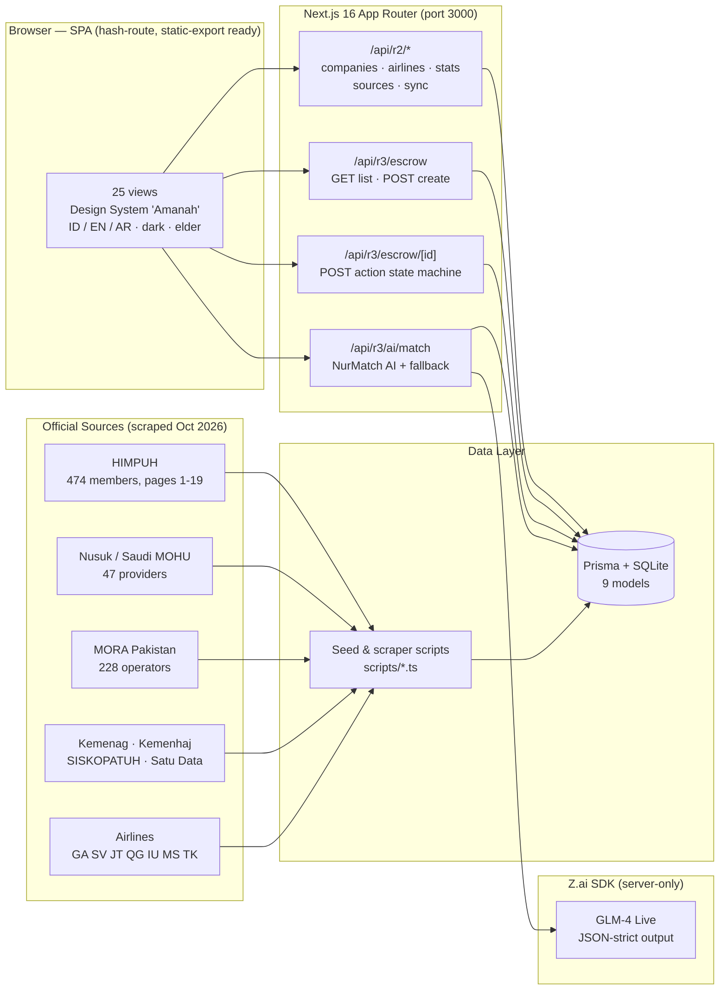
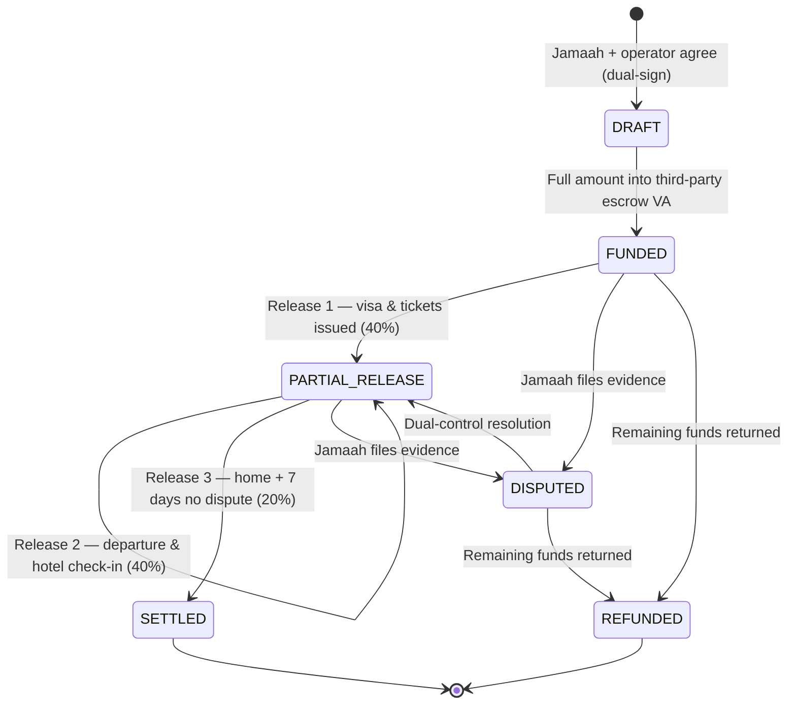

<div align="center">

# SolusiHajj

### The World's Largest Hajj & Umrah Marketplace — "Amanah Anda, Aman."

**One gateway for every licensed Umrah & Hajj operator in Asia. Packages from real operators.
Money guarded by escrow. Trust verified in five layers. AI that explains itself.**

[](https://nextjs.org)
[](https://www.typescriptlang.org)
[](https://www.prisma.io)
[](https://tailwindcss.com)
[](https://ui.shadcn.com)
[](https://z.ai)
[](https://peraturan.bpk.go.id)


**[Readme Bahasa Indonesia](README_ID.md) — versi Indonesia tersedia**

</div>

---

## Why SolusiHajj Exists

Every year, millions of Indonesian and Asian pilgrims hand over **their life savings** to Umrah operators —
often after seeing nothing but an Instagram post. Frauds, vanished operators, hotel bait-and-switch:
the industry's trust deficit is measured in billions of rupiah and broken promises.

SolusiHajj is the answer: a **pure marketplace** (a *wadah*) that aggregates every licensed operator —
**PPIU, PIHK, BPW, KBIHU** across Asia — under one trust-first platform. The platform never sells its own
packages. Operators supply the packages; SolusiHajj supplies **verification, escrow, transparency, and reach**.

| Pillar | What it means |
|---|---|
| **Marketplace Engine** | 27 packages, 10 group charter flights, city filters, monthly price calendar, side-by-side compare |
| **Trust & Syariah** | Verifikasi 5 Lapis, AmanahEscrow 40/40/20 with dual-control, Saksi Jamaah review-gated ratings, public sanctions register |
| **Real Data** | 796 organizations indexed from 9+ official government/association sources — every row has provenance |
| **NurMatch AI** | A live LLM advisor that recommends only from real catalog + database candidates, and shows its reasoning |
| **Asia-Wide Directory** | Indonesia, Saudi Arabia (Nusuk/MOHU), Pakistan (MORA), Malaysia, Singapore, Brunei, Thailand |
| **Radical Accessibility** | Elder mode (17 → 19.5 px), dark "Malam Madinah" mode, ID/EN/AR, 48 px touch targets |

---

## The Numbers (October 2026)

| Metric | Value | Source |
|---|---|---|
| Organizations in database | **796** | Live SQLite, provenance-audited |
| ─ PPIU (Umrah operators, ID) | 258 | Kemenag + HIMPUH full scrape |
| ─ PIHK (Hajj-special organizers, ID) | 261 | Kemenag KMA + HIMPUH |
| ─ USP (Saudi Umrah Service Providers) | 47 | Nusuk — official MOHU platform |
| ─ UTO (Pakistan Umrah Tour Operators) | 228 | MORA Pakistan official register |
| ─ BPW (travel bureaus) | 2 | HIMPUH |
| Countries covered | **3 core + 4 partner** | ID, PK, SA + MY, SG, BN, TH |
| HIMPUH members scraped | **474 / 474** with full detail | himpuh.or.id pages 1–19 |
| Airlines / routes indexed | 7 / 19 (real 2025 schedules) | Kemenag decree + airline releases |
| Packages / charter flights | 27 / 10 | Curated catalog |
| Escrow contracts (demo-pipeline) | 5 across all states | DRAFT → SETTLED covered |
| JSON-LD structured data blocks | 29+ | Organization → Dataset → HowTo |
| UI views | 25 | Single hash-route SPA, static-export ready |

---

## Release Ladder

| Release | Codename | Status | Headline |
|---|---|---|---|
| **R1** | Gerbang Kepercayaan | DONE | Trust-first homepage, 24-package catalog, public "Cek Izin PPIU" tool, hajj savings calculator |
| **R1.5** | Marketplace Asia Superapp | DONE | 5-country directory, compare tray, 29 JSON-LD blocks, dark + elder modes, ID/EN/AR |
| **R2** | Fondasi Data Nasional | DONE | Real national database from 9 official sources, airlines module, live sync pipeline with audit trail |
| **R3** | AmanahEscrow Aktif + NurMatch AI | **THIS RELEASE** | Working escrow state machine (create → fund → release 40/40/20 → dispute → resolve → refund) + live LLM advisor |
| **R4** | Production Hardening | Next | Bank VA integration, KYC, operator dashboards, multi-region deployment |

---

## Architecture



### Data Provenance — every row knows where it came from

```
HIMPUH (474) ──► fetch 19 list pages ──► fetch 474 detail pages ──► parse jenis/registrasi/phone/email/web
Nusuk   (47) ──► provider cards ──► 47 profile pages (city, phone, CF-decoded email, about)
MORA PK (228)──► official document table ──► 344 rows ──► filter to 228 company-like names
                                    │
                                    ▼
                    normalize(name) dedup-index ──► merge or create Company
                                    │
                                    ▼
              DataSource.recordsIndexed++  ·  SyncEvent(SUCCESS, note)  ──► audit trail
```

### AmanahEscrow — the money never touches the operator first



**Dual-control:** an operator can only *request* a release; the platform approves it as a second key.
Every transition writes an immutable `EscrowEvent` — the pilgrim (Saksi Jamaah) watches everything.

### NurMatch AI — helpful, but caged

1. Server filters **real candidates**: top-10 catalog packages within 115% of budget + 8 verified operators from the national DB.
2. A strict system prompt forces **JSON-only** output, warm elder-friendly Indonesian, and forbids inventing products.
3. The LLM (GLM-4) reasons over price fit, hotel distance-to-Haram, month, and Saksi Jamaah ratings.
4. If the AI is unavailable, a **transparent deterministic scorer** takes over — the feature never dies.
5. Every session is stored (`AiMatchSession`) — recommendations are auditable, not a black box.

---

## Quick Start

```bash
# 1. Install
bun install

# 2. Database (schema push; SQLite file at db/custom.db)
bun run db:push

# 3. (Optional) Re-seed the national directory from scraped JSON
bun scripts/seed-r2.ts && bun scripts/seed-r3.ts

# 4. Dev server — http://localhost:3000
bun run dev

# 5. Lint
bun run lint
```

Re-run the scrapers anytime (resumable, checkpointed):

```bash
bun scripts/fetch-himpuh-full.ts   # 19 list pages + 474 detail pages -> scripts/data/himpuh-full.json
bun scripts/fetch-asia.ts          # Nusuk 47 providers + MORA Pakistan -> scripts/data/asia-sources.json
```

---

## API Reference

| Endpoint | Method | Purpose |
|---|---|---|
| `/api/r2/companies` | GET | Directory search: `q, type, province, status, limit` + facets |
| `/api/r2/airlines` | GET | Airlines + real routes, `byService` filter |
| `/api/r2/stats` | GET | Aggregates: totals, by type/status/country/province |
| `/api/r2/sources` | GET | Data sources + recent sync events |
| `/api/r2/sync` | POST | Trigger a validated pipeline sync (audit-logged) |
| `/api/r3/escrow` | GET / POST | List contracts + volume / create contract (auto 40-40-20 milestones) |
| `/api/r3/escrow/[id]` | GET / POST | Full detail + audit trail / action: `FUND, RELEASE, DISPUTE, RESOLVE, REFUND` |
| `/api/r3/ai/match` | GET / POST | Recent AI sessions / profile → live LLM recommendation |

Escrow action rules enforced server-side: sequential releases only, no release before `FUNDED`,
dispute requires ≥ 10-character evidence note, refund only of unreleased remainder.

---

## Data Models (Prisma / SQLite)

`DataSource` · `SyncEvent` · `Company` (unique name+orgType, indexed) · `SanctionRecord` ·
`GovRegulation` · `Airline` · `FlightRoute` · `EscrowContract` · `EscrowMilestone` (unique contractId+seq) ·
`EscrowEvent` (append-only) · `AiMatchSession`

---

## Design System "Amanah"

| Token | Value |
|---|---|
| Green (primary) | `#0E6B4E` |
| Gold (accent) | `#C9A227` |
| Ivory (background) | `#FAF7F2` |
| Body font | Plus Jakarta Sans (17 px base) |
| Display/Arabic | Amiri (RTL-aware) |
| Touch targets | ≥ 48 px |
| Radius / shadows | 16 / 12 px, 3-level warm-green shadows |
| Elder mode | body 17 → 19.5 px, persistable |
| Dark mode | "Malam Madinah" palette |

---

## Screenshots

| | |
|---|---|
|  |  |
| *Pusat AmanahEscrow — live contracts, Rp 428 jt under management* | *NurMatch AI — live GLM-4 answer citing real packages & operators* |
|  |  |
| *Pusat Data Nasional — 796 organizations with provenance* | *Homepage — trust-first marketplace* |

---

## Security & Compliance

- **UU PDP 27/2022** aligned: no personal data in AI sessions, encrypted fields planned per doc 23.
- Escrow ledger is **append-only** (`EscrowEvent`); releases require dual-control records.
- Public **sanctions register** (SanctionRecord) keeps flagged operators visible.
- No quota selling, no package fabrication — platform is a pure *wadah* (container).
- z-ai-web-dev-sdk is **server-side only**; the AI key never reaches the browser.

---

## Repository Layout

```
src/
  app/
    page.tsx                 # Single visible route (SPA shell)
    api/r2/                  # Directory, airlines, stats, sources, sync
    api/r3/escrow/           # Escrow list/create + [id] state machine
    api/r3/ai/match/         # NurMatch AI (LLM live + fallback)
  components/solusihajj/
    app.tsx                  # Hash-router view map (25 views)
    chrome.tsx               # Header/Footer/WA/i18n/prefs
    pages/                   # home, catalog, ppiu, trust, market, resources,
                             # data, airlines, escrow-live, nurmatch-ai, tools, static
  data/                      # 27 packages, operators, glossary, SEO map
  lib/solusihajj/            # router, seo, i18n, wa, compare
prisma/schema.prisma         # 11 models
scripts/
  fetch-himpuh-full.ts       # HIMPUH scraper (resumable, checkpointed)
  fetch-asia.ts              # Nusuk + MORA Pakistan scraper
  seed-r2.ts / seed-r3.ts    # Provenance-logged importers
docs/ (download/solusihajj/docs/)  # 39 NEXUS PROTOCOL documents
```

---

## Roadmap

- **R4-Production**: bank VA integration (Bank Syariah), KYC for operators, operator self-service dashboard,
  contract e-signature, WebPush milestone notifications.
- **Data**: nightly incremental rescrapes, Saudi MOHU eservices when reachable, more Asian registries
  (India, Bangladesh, Malaysia TABUNG HAJI ecosystem).
- **AI**: voice input for elders, Arabic & English reasoning, itinerary-aware packing lists.

## Systems Architecture & Support

SolusiHajj is engineered under the discipline of **GUNARA MASTER SYSTEM v3.0** and the **NEXUS PROTOCOL v1.0**
document suite. System architecture, quality gates, and data pipelines are supported by:

> **by Gugun Gunara — Muhammad Lutfi Azmi** (prabudanling · Santri Angon)
> **PT Top Konsultan Internasional** ([topkonsultan.web.id](https://topkonsultan.web.id)) ·
> **PT Digital Bisnis Manajemen** ([digiman.id](https://digiman.id))

| Channel | Link |
|---|---|
| Facebook | [@bossdanling](https://www.facebook.com/bossdanling) |
| X | [@gunzz_krenzz](https://x.com/gunzz_krenzz) |
| Instagram | [@prabudanling](https://www.instagram.com/prabudanling) |
| TikTok | [@gunaracorp](https://www.tiktok.com/@gunaracorp) |
| Threads | [@prabudanling](https://www.threads.com/@prabudanling) |
| Reddit | [u/prabudanling](https://www.reddit.com/user/prabudanling/) |

See also [`public/humans.txt`](public/humans.txt) — the people behind the system.

## Related Documents

The complete blueprint lives in **39 NEXUS PROTOCOL documents**
(`/home/z/my-project/download/solusihajj/docs/`): business requirements, personas, sitemap,
wireframes, database schema, API spec, security protocol, deployment runbook, and more.

---

<div align="center">

**SolusiHajj — Amanah Anda, Aman.**
*Marketplace ibadah terbesar & teraman di Asia — dibangun dengan data resmi, escrow nyata, dan AI yang jujur.*

</div>
