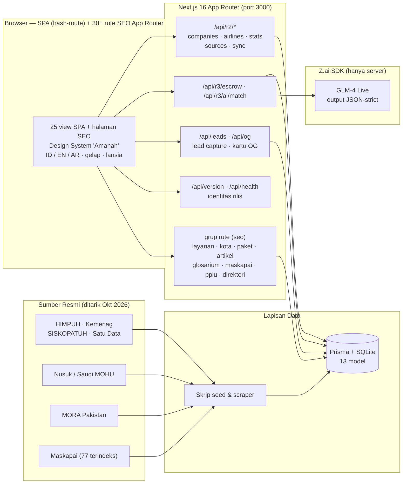
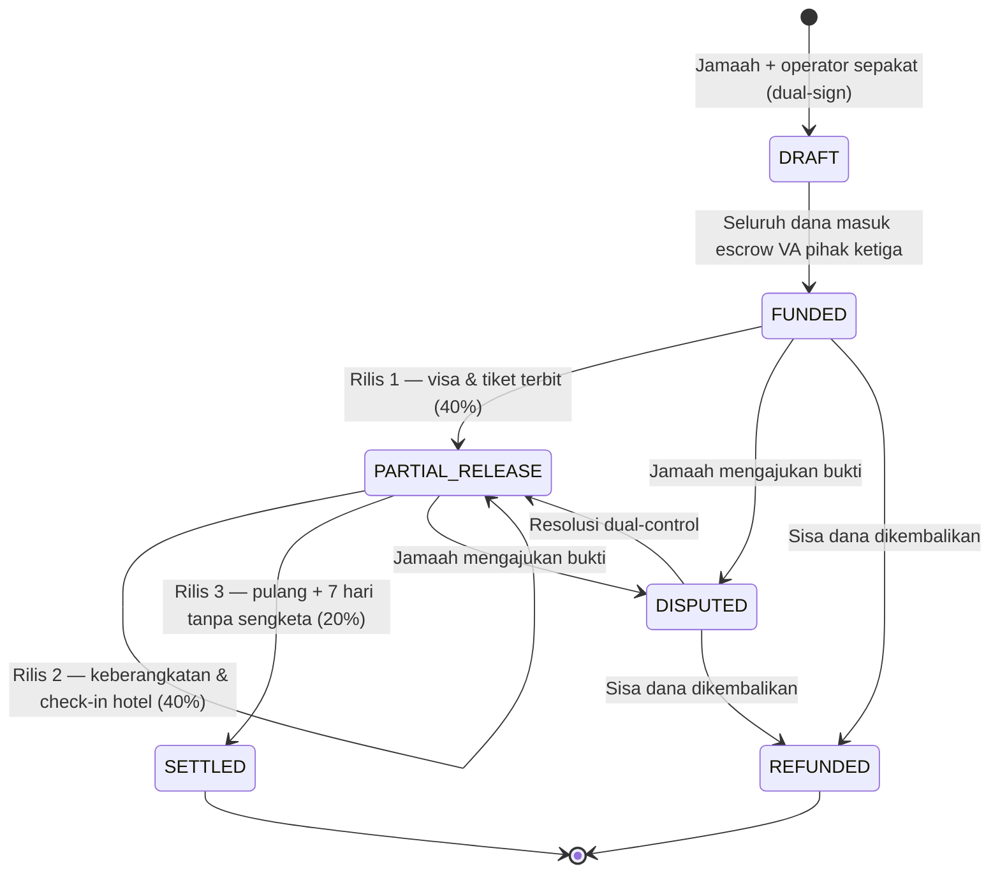

<div align="center">

# SolusiHajj

### Marketplace Haji & Umrah Terbesar Dunia — "Amanah Anda, Aman."

**Satu gerbang untuk semua penyelenggara Umrah & Haji berizin di Asia. Paket dari operator sungguhan.
Dana dijaga escrow. Kepercayaan diverifikasi lima lapis. AI yang jujur menjelaskan dirinya.**

[](CHANGELOG.md)
[](CHANGELOG.md)
[](https://semver.org)
[](public/humans.txt)
[](https://nextjs.org)
[](https://www.typescriptlang.org)
[](https://www.prisma.io)
[](https://tailwindcss.com)
[](https://ui.shadcn.com)
[](https://z.ai)
[](https://peraturan.bpk.go.id)

**[English README](README.md) — English version available**

</div>

---

## ⚡ Ringkasan Rilis — SolusiHajj v2.1.0 "Sinyal Global" (22 Oktober 2026)

v2.1.0 mengirim **Prioritas 5 — mesin penemuan & distribusi**: `llms.txt` untuk LLM crawler,
RSS kanonik, hreflang id/en via next-intl, halaman `/bandingkan`, dan katalog berfaset
720 halaman — sitemap kini **14.714 URL**. Tata kelola dikunci **CI Release Gate**
(pre-commit hook menolak drift versi). v2.0.0 mengaktifkan **SolusiHajj Release System**:
setiap perintah dan perubahan wajib berversi (SemVer) — lihat [CHANGELOG.md](CHANGELOG.md)
dan [WORKLOG.md](WORKLOG.md).

| Versi | Kode Rilis | Sorotan |
|---|---|---|
| **v2.1.0** | Sinyal Global | `llms.txt` · RSS kanonik `/feed.xml` · hreflang id/en (10 halaman `/en`, next-intl) · halaman `/bandingkan` · katalog berfaset 720 halaman `/katalog` · CI Release Gate · badge rilis di admin · sitemap 13.984 → **14.714** |
| **v2.0.0** | Nexus Governance | Sistem versioning aktif — file VERSION, CHANGELOG, WORKLOG ber-versi, `/api/version`, stempel versi di footer, git tag |
| **v1.5.0** | Kelas Dunia | Header & navigasi didesain ulang setara konsultan global (utility bar kepercayaan, mega menu, drawer mobile kelas aplikasi) |
| **v1.4.0** | Mesin Konten | Mesin Artikel 4 → **112 artikel** (±90.000 kata, 8 kategori, silo 3 lapis) + fix permanen hydration mismatch |
| **v1.3.0** | Kartu Dinamis | Kartu OG dinamis untuk **seluruh 13.984 halaman** (harga/rating/badge) + image sitemap (13.831 gambar) |
| **v1.2.0** | Matrix 9.450 | **9.450 halaman programmatic-SEO** (210 layanan × 45 kota, ISR) + mesin lead capture (`ServiceLead`, bernomor referensi) |
| **v1.1.x** | Gerbang SEO | Fondasi SEO App Router — 210 layanan, 45 kota, halaman legal, sitemap 4.418 URL, JSON-LD penuh |
| **v1.0.0** | Fondasi Amanah | SolusiHajj R3 terinstall & terverifikasi — mesin state escrow, NurMatch AI, database nasional 3.966 organisasi |

Cek rilis yang berjalan kapan saja:

```bash
curl http://localhost:3000/api/version
# { "version": "2.1.0", "label": "SolusiHajj v2.1.0", "codename": "Sinyal Global", ... }
```

---

## Mengapa SolusiHajj Ada

Setiap tahun, jutaan jamaah di Indonesia dan Asia menyerahkan **tabungan hidupnya** kepada
penyelenggara umrah — sering kali hanya bermodal unggahan Instagram. Travel hilang, hotel diganti sepihak,
janji tak ditepati: defisit kepercayaan industri ini diukur dalam miliaran rupiah.

SolusiHajj adalah jawabannya: **marketplace murni** (wadah) yang menghimpun semua penyelenggara berizin —
**PPIU, PIHK, BPW, KBIHU** di seluruh Asia — dalam satu platform yang mengutamakan kepercayaan.
Platform tidak pernah menjual paket milik sendiri. Operator menyuplai paket; SolusiHajj menyuplai
**verifikasi, escrow, transparansi, dan jangkauan**.

| Pilar | Maknanya |
|---|---|
| **Mesin Marketplace** | 27 paket, 10 jadwal charter grup, filter kota, kalender harga bulanan, bandingkan side-by-side |
| **Kepercayaan & Syariah** | Verifikasi 5 Lapis, AmanahEscrow 40/40/20 dengan dual-control, rating berbasis Saksi Jamaah, daftar sanksi publik |
| **Data Riil** | **3.966 organisasi** terindeks dari 9+ sumber resmi pemerintah/asosiasi — setiap baris punya jejak sumber |
| **SEO Programatik** | **13.984 URL** dalam satu sitemap: halaman layanan, landing kota, matriks 9.450 halaman layanan×kota, pusat konten 112 artikel |
| **NurMatch AI** | Penasihat LLM hidup yang hanya merekomendasikan dari kandidat katalog + database nyata, dan menunjukkan alasannya |
| **Direktori Asia** | Indonesia, Arab Saudi (Nusuk/MOHU), Pakistan (MORA), Malaysia, Singapura, Brunei, Thailand |
| **Aksesibilitas Radikal** | Mode lansia (17 → 19,5 px), mode gelap "Malam Madinah", ID/EN/AR, target sentuh 48 px, header kelas konsultan |

---

## Angka Kunci (terverifikasi live — Oktober 2026)

| Metrik | Nilai | Sumber |
|---|---|---|
| URL sitemap | **14.714** | `sitemap.xml` live (1 file, < 50 MB) |
| ─ Matriks programatik (layanan × kota) | 9.450 | `/layanan/[slug]/dari-[kota]`, ISR 24 jam |
| ─ Direktori (profil dari DB) | 3.966 | SQLite hidup, provenance diaudit |
| ─ Katalog berfaset (v2.1.0) | 720 | `/katalog` — 5 tipe + 335 kota + 31 provinsi + 53 prov×tipe + 293 kota×tipe |
| ─ Artikel + hub kategori | 112 + 8 | Mesin konten E-E-A-T, 8 kategori |
| ─ Halaman Inggris (hreflang id/en) | 10 | `/en`, `/en/services`, `/en/packages`, … (next-intl) |
| ─ Layanan / kota / paket / glosarium / maskapai / PPIU | 225 / 46 / 28 / 35 / 77 / 19 | Rute SEO statis |
| Kartu OG dinamis 1200×630 | **14.500+** | Image sitemap extensions |
| Tautan hreflang di sitemap | 60 | `id` / `en` / `x-default` per halaman berpadanan |
| RSS feed | `/feed.xml` (50 terbaru) | `/api/rss` → redirect 308 |
| Manifest llms.txt | `/llms.txt` | Penemuan LLM-crawler (konvensi llms.txt) |
| Organisasi di database | **3.966** | 2.670 PPIU · 1.019 PIHK · 228 UTO · 47 USP · 2 BPW |
| Organisasi terverifikasi | 3.619 | Status AKTIF/TERDAFTAR |
| Lead capture | `ServiceLead` + ref `SH-LEAD-YYYY-XXXXX` | Rate limit, honeypot, atribusi pagePath |
| Tipe JSON-LD | 12+ | Organization, Service+Offer, FAQPage, Article, ItemList, Dataset, HowTo… |
| View UI | 25 | SPA hash-route tunggal + 40+ rute SEO App Router |

---

## Tangga Rilis

| Rilis | Versi | Kode | Status | Sorotan |
|---|---|---|---|---|
| **R1** | — | Gerbang Kepercayaan | SELESAI | Beranda trust-first, katalog 24 paket, tool publik "Cek Izin PPIU", kalkulator simpanan haji |
| **R1.5** | — | Marketplace Asia Superapp | SELESAI | Direktori 5 negara, compare tray, 29 blok JSON-LD, mode gelap + lansia, ID/EN/AR |
| **R2** | — | Fondasi Data Nasional | SELESAI | Database nasional nyata dari 9 sumber resmi, modul maskapai, pipeline sync ter-audit |
| **R3** | **v1.0.0 → v1.5.0** | AmanahEscrow + NurMatch + SEO Matrix | **RILIS INI** | Mesin state escrow, penasihat LLM live, mesin SEO 13.984 URL, hub 112 artikel, header kelas konsultan |
| **R4** | v3.x (rencana) | Production Hardening | Berikutnya | Integrasi VA bank, KYC, dashboard operator, deployment multi-region |

---

## Arsitektur



### Jejak Sumber Data — setiap baris tahu asalnya

```
HIMPUH (474) ──► 19 halaman daftar ──► 474 halaman detail ──► parse jenis/registrasi/telepon/email/web
Nusuk   (47) ──► kartu provider ──► 47 halaman profil (kota, telepon, email CF-decoded, tentang)
MORA PK (228)──► tabel dokumen resmi ──► 344 baris ──► 228 nama ala perusahaan
                                    │
                                    ▼
                    normalize(name) indeks dedup ──► merge atau buat Company (3.966 baris)
                                    │
                                    ▼
              DataSource.recordsIndexed++  ·  SyncEvent(SUCCESS, catatan)  ──► jejak audit
```

### AmanahEscrow — dana tidak pernah menyentuh operator lebih dulu



**Dual-control:** operator hanya bisa *meminta* rilis; platform menyetujui sebagai kunci kedua.
Setiap transisi menulis `EscrowEvent` immutable — jamaah (Saksi Jamaah) mengawasi semuanya.

### NurMatch AI — membantu, tapi dikandang

1. Server memfilter **kandidat nyata**: top-10 paket katalog dalam 115% anggaran + 8 operator terverifikasi dari DB nasional.
2. System prompt ketat memaksa **output JSON saja**, bahasa Indonesia hangat ramah lansia, dan melarang mengarang produk.
3. LLM (GLM-4) menimbang kecocokan harga, jarak hotel ke Haram, bulan, dan rating Saksi Jamaah.
4. Jika AI tak tersedia, **pemberat deterministik yang transparan** mengambil alih — fitur tidak pernah mati.
5. Setiap sesi tersimpan (`AiMatchSession`) — rekomendasi dapat diaudit, bukan kotak hitam.

### Mesin SEO programatik (v1.1 → v1.4)

- **Matriks layanan×kota** — 9.450 halaman statis (`/layanan/[slug]/dari-[kota]`), masing-masing dengan
  intro unik, konteks bandara/charter, FAQ gabungan, silo dua arah, metadata + kartu OG per kombinasi.
- **Pusat konten** — 112 artikel dalam 8 kategori (Panduan Umrah, Manasik & Doa, Visa & Dokumen,
  Hotel & Transportasi, Biaya & Keuangan, Keluarga & Lansia, Musim & Waktu, Keamanan & Verifikasi),
  dengan arsitektur silo indeks → kategori → detail → related.
- **Structured data di mana-mana** — Service+Offer, FAQPage, Article, CollectionPage, BreadcrumbList,
  Organization, ItemList, Dataset, HowTo, DefinedTerm, TravelAgency, SearchAction.
- **Kartu OG dinamis** — satu API route (`/api/og`) merender kartu 1200×630 ber-brand (harga, rating,
  badge verifikasi) untuk setiap halaman; ter-wire ke metadata + image sitemap.

---

## Mulai Cepat

```bash
# 1. Install
bun install

# 2. Database (schema push; file SQLite di db/custom.db)
bun run db:push

# 3. (Opsional) Seed ulang direktori nasional dari JSON hasil scraping
bun scripts/seed-r2.ts && bun scripts/seed-r3.ts

# 4. Dev server — http://localhost:3000
bun run dev

# 5. Lint
bun run lint

# 6. Verifikasi rilis yang berjalan
curl http://localhost:3000/api/version
```

Jalankan ulang scraper kapan saja (resumable, checkpointed):

```bash
bun scripts/fetch-himpuh-full.ts   # 19 halaman daftar + 474 halaman detail -> scripts/data/himpuh-full.json
bun scripts/fetch-asia.ts          # Nusuk 47 provider + MORA Pakistan -> scripts/data/asia-sources.json
```

---

## Referensi API

| Endpoint | Metode | Fungsi |
|---|---|---|
| `/api/version` | GET | **Identitas rilis** — versi, label, kode rilis, tanggal build (SolusiHajj Release System) |
| `/api/health` | GET | Healthcheck — latensi DB + **blok versi** + runtime |
| `/api/r2/companies` | GET | Pencarian direktori: `q, type, province, status, limit` + facet |
| `/api/r2/airlines` | GET | Maskapai + rute nyata, filter `byService` |
| `/api/r2/stats` | GET | Agregat: total, per tipe/status/negara/provinsi |
| `/api/r2/sources` | GET | Sumber data + sync event terkini |
| `/api/r2/sync` | POST | Picu sync pipeline tervalidasi (ter-audit) |
| `/api/r3/escrow` | GET / POST | Daftar kontrak + volume / buat kontrak (milestone 40-40-20 otomatis) |
| `/api/r3/escrow/[id]` | GET / POST | Detail penuh + jejak audit / aksi: `FUND, RELEASE, DISPUTE, RESOLVE, REFUND` |
| `/api/r3/ai/match` | GET / POST | Sesi AI terkini / profil → rekomendasi LLM live |
| `/api/leads` | POST / GET | **Lead capture** — POST publik (rate limit, honeypot) / GET admin |
| `/api/og` | GET | **Kartu OG dinamis** 1200×630 — param `t, chip, price, foot, k, rating, reviews, badge, sub` |
| `/feed.xml` | GET | **RSS 2.0 kanonik** — 50 artikel terbaru (DB → fallback statis, tidak pernah 500) |
| `/api/rss` | GET | Endpoint feed lama — **redirect 308** ke `/feed.xml` |
| `/llms.txt` | GET | **Manifest penemuan LLM** (konvensi llms.txt) — peta situs terkurasi untuk AI crawler |

Aturan aksi escrow ditegakkan server-side: rilis berurutan saja, tanpa rilis sebelum `FUNDED`,
sengketa wajib catatan bukti ≥ 10 karakter, refund hanya dari sisa yang belum dirilis.

---

## Model Data (Prisma / SQLite)

`DataSource` · `SyncEvent` · `Company` (unik name+orgType, terindeks) · `SanctionRecord` ·
`GovRegulation` · `Airline` · `FlightRoute` · `EscrowContract` · `EscrowMilestone` (unik contractId+seq) ·
`EscrowEvent` (append-only) · `AiMatchSession` · `ServiceLead` (ref unik, atribusi pagePath)

---

## Design System "Amanah"

| Token | Nilai |
|---|---|
| Hijau (primer) | `#0E6B4E` |
| Emas (aksen) | `#C9A227` |
| Gading (latar) | `#FAF7F2` |
| Font body | Plus Jakarta Sans (basis 17 px) |
| Display/Arab | Amiri (RTL-aware) |
| Target sentuh | ≥ 48 px |
| Radius / bayangan | 16 / 12 px, 3 tingkat bayangan hijau-hangat |
| Mode lansia | body 17 → 19,5 px, dapat disimpan |
| Mode gelap | palet "Malam Madinah" |
| Header | CHROME R2 — kelas konsultan: utility bar kepercayaan + mega menu + drawer mobile |

---

## SolusiHajj Release System (tata kelola versioning)

Repositori ini diatur oleh **SolusiHajj Release System** — setiap perintah dan setiap perubahan
wajib memiliki versi. Praktik berstandar internasional:

| Artefak | Peran |
|---|---|
| [`VERSION`](VERSION) | Nomor versi kanonik (root, satu baris) |
| [`CHANGELOG.md`](CHANGELOG.md) | Keep a Changelog 1.1.0 — setiap rilis, terkategori (Added/Changed/Fixed/Verified) |
| [`WORKLOG.md`](WORKLOG.md) | Ledger task engineering — kronologis, setiap task distempel `[vX.Y.Z]` |
| `src/lib/version.ts` | Sumber kebenaran runtime (diimpor API + footer + badge admin — jangan hardcode versi di tempat lain) |
| `/api/version` | Identitas rilis live untuk verifikasi pasca-deploy |
| Git tag `vX.Y.Z` | Snapshot rilis immutable |
| **CI Release Gate** | `githooks/pre-commit` → `scripts/verify-version-sync.mjs` — **menolak commit** bila VERSION ≠ package.json ≠ version.ts ≠ CHANGELOG. Aktifkan di clone baru: `git config core.hooksPath githooks`. Cek manual: `bun run verify:version` |

**Kebijakan Semantic Versioning:**

- **MAJOR** — perombakan tata kelola/arsitektur atau lompatan tangga produk (R-ladder).
- **MINOR** — fitur baru tanpa merusak (halaman, mesin, modul baru).
- **PATCH** — perbaikan bug dan hardening tanpa fitur baru.

**SOP Rilis (naikkan versi):**

1. Perbarui `APP_VERSION`, `APP_CODENAME`, `APP_BUILD_DATE` di `src/lib/version.ts`.
2. Sinkronkan `VERSION` (root) dan `"version"` di `package.json`.
3. Tambah seksi baru di paling atas `CHANGELOG.md` (format Keep a Changelog).
4. Tambahkan entri task ke `WORKLOG.md` distempel versi baru.
5. Commit — **hook Release Gate** memblokir commit bila versi drift — lalu `git tag -a vX.Y.Z -m "SolusiHajj vX.Y.Z — <kode rilis>"`.
6. Push kode + tag ke remote agar rilis immutable: `git push origin main --follow-tags` (remote: `github.com/prabudanling/solusihajj`).
7. Verifikasi: `curl /api/version` mengembalikan versi baru; stempel footer + badge admin ikut otomatis.

---

## Struktur Repositori

```
VERSION                     # Nomor rilis kanonik
CHANGELOG.md                # Keep a Changelog — riwayat rilis
WORKLOG.md                  # Ledger task engineering ber-versi
src/
  app/
    page.tsx                # Shell SPA (hash-route, 25 view)
    (seo)/                  # 40+ rute SEO App Router
      layanan/[slug]/[kota] # Matriks 9.450 halaman layanan×kota (ISR)
      artikel/              # Hub 112 artikel + 8 rute kategori
      katalog/              # Katalog berfaset 720 halaman (tipe × kota × provinsi)
      bandingkan/           # Halaman bandingkan paket (picker klien + tabel SEO)
      kota/ paket/ glosarium/ maskapai/ ppiu/ direktori/ legal
    (en)/en/                # 10 halaman Inggris — hreflang id/en (next-intl)
    llms.txt/ feed.xml/     # Manifest LLM + RSS kanonik
    api/
      version/ health/      # Identitas rilis + healthcheck
      leads/ og/ rss/       # Lead capture + kartu OG + redirect feed lama
      r2/                   # Direktori, maskapai, stats, sumber, sync
      r3/                   # Mesin state escrow + NurMatch AI
  components/
    solusihajj/             # View SPA + header/footer CHROME R2
    seo/                    # JSON-LD, form lead, komponen silo + compare-picker
    admin/ views/ ui/       # Dashboard admin (badge rilis), view, shadcn/ui
  data/
    services/               # 210 layanan, 14 kategori
    article-engine/         # 108 artikel (6 batch) + index
    cities.ts               # 45 kota keberangkatan
  i18n/                     # Routing + request config next-intl (id/en)
  lib/
    version.ts              # Identitas rilis runtime (sumber kebenaran)
    i18n-routes.ts          # Peta rute hreflang id↔en
    facets.ts               # Agregasi Prisma katalog berfaset
    og.ts solusihajj/       # Helper OG, router/seo/i18n/wa/compare
messages/                   # Katalog pesan next-intl (id.json, en.json)
githooks/pre-commit         # CI Release Gate (core.hooksPath → githooks)
prisma/schema.prisma        # 13 model (termasuk ServiceLead)
scripts/                    # Scraper, seeder, daemon, verify-version-sync.mjs
docs/                       # Blueprint NEXUS PROTOCOL (39 dokumen)
```

---

## Tangkapan Layar

| | |
|---|---|
|  |  |
| *Pusat AmanahEscrow — kontrak live, Rp 428 jt dikelola* | *NurMatch AI — jawaban GLM-4 live merujuk paket & operator nyata* |
|  |  |
| *Pusat Data Nasional — 3.966 organisasi berjejak sumber* | *Beranda — marketplace trust-first, header kelas konsultan* |

---

## Keamanan & Kepatuhan

- Selaras **UU PDP 27/2022**: tanpa data pribadi di sesi AI, enkripsi bidang direncanakan per dok 23.
- Buku besar escrow **append-only** (`EscrowEvent`); rilis butuh catatan dual-control.
- **Daftar sanksi publik** (SanctionRecord) menjaga operator bermasalah tetap terlihat.
- Lead capture diperkuat: rate limit (5/menit/IP), bidang honeypot, validasi format telepon, baca khusus admin.
- Tanpa jual kuota, tanpa paket karangan — platform murni *wadah*.
- z-ai-web-dev-sdk **hanya di server**; kunci AI tidak pernah sampai ke browser.

---

## Peta Jalan

- **v2.1 (Prioritas 5)** — ✅ **TERKIRIM di v2.1.0 "Sinyal Global"**: `llms.txt`, RSS kanonik, hreflang id/en (next-intl), halaman SEO `/bandingkan`, katalog berfaset (sitemap 13.984 → 14.714).
- **Kandidat berikutnya** — upgrade schema artikel (VideoObject/Podcast), llms-full.txt, halaman detail Inggris, RSS per kategori.
- **R4-Production (v3.x)** — integrasi VA bank (Bank Syariah), KYC operator, dashboard mandiri operator,
  e-signature kontrak, notifikasi milestone WebPush.
- **Data** — rescrape inkremental malam hari, eservices Saudi MOHU saat terjangkau, register Asia lainnya
  (India, Bangladesh, ekosistem TABUNG HAJI Malaysia).
- **AI** — input suara untuk lansia, penalaran Arab & Inggris, packing list sadar-itinerary.

## Arsitektur Sistem & Dukungan

SolusiHajj direkayasa di bawah disiplin **GUNARA MASTER SYSTEM v3.0**, rangkaian dokumen
**NEXUS PROTOCOL v1.0**, dan **SolusiHajj Release System v2.1.0**. Arsitektur sistem, quality gate,
dan pipeline data didukung oleh:

> **by Gugun Gunara — Muhammad Lutfi Azmi** (prabudanling · Santri Angon)
> **PT Top Konsultan Internasional** ([topkonsultan.web.id](https://topkonsultan.web.id)) ·
> **PT Digital Bisnis Manajemen** ([digiman.id](https://digiman.id))

| Kanal | Tautan |
|---|---|
| Facebook | [@bossdanling](https://www.facebook.com/bossdanling) |
| X | [@gunzz_krenzz](https://x.com/gunzz_krenzz) |
| Instagram | [@prabudanling](https://www.instagram.com/prabudanling) |
| TikTok | [@gunaracorp](https://www.tiktok.com/@gunaracorp) |
| Threads | [@prabudanling](https://www.threads.com/@prabudanling) |
| Reddit | [u/prabudanling](https://www.reddit.com/user/prabudanling/) |

Lihat juga [`public/humans.txt`](public/humans.txt) — orang-orang di balik sistem.

## Dokumen Terkait

Blueprint lengkap ada di **39 dokumen NEXUS PROTOCOL**
(`/home/z/my-project/download/solusihajj/docs/`): kebutuhan bisnis, persona, sitemap,
wireframe, skema database, spesifikasi API, protokol keamanan, runbook deployment, dan lainnya.

---

<div align="center">

**SolusiHajj — Amanah Anda, Aman.**
*Marketplace ibadah terbesar & teraman di Asia — dibangun dengan data resmi, escrow nyata, dan AI yang jujur.*

**Rilis aktif: SolusiHajj v2.1.0 — "Sinyal Global"** · [Changelog](CHANGELOG.md) · [Worklog](WORKLOG.md)

</div>
