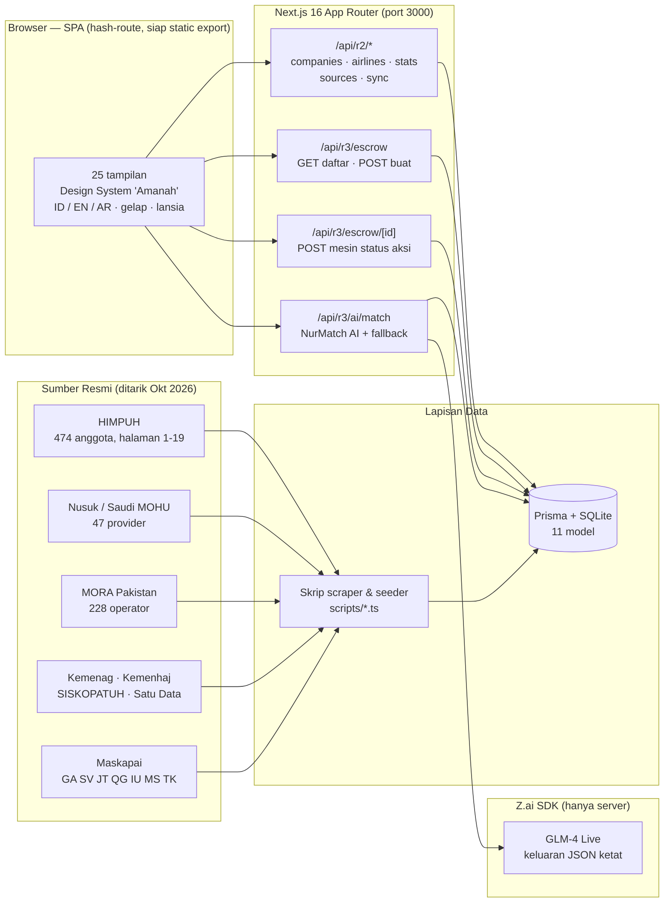

<div align="center">

# SolusiHajj

### Marketplace Haji & Umrah Terbesar Dunia — "Amanah Anda, Aman."

**Satu gerbang untuk semua penyelenggara Umrah & Haji berizin di Asia. Paket dari operator sungguhan.
Dana dijaga escrow. Kepercayaan diverifikasi lima lapis. AI yang jujur menjelaskan dirinya.**

[](https://nextjs.org)
[](https://www.typescriptlang.org)
[](https://www.prisma.io)
[](https://tailwindcss.com)
[](https://ui.shadcn.com)
[](https://z.ai)
[](https://peraturan.bpk.go.id)


**[English README](README.md) — English version available**

</div>

---

## Mengapa SolusiHajj Ada

Setiap tahun, jutaan jamaah di Indonesia dan Asia menyerahkan **tabungan hidupnya** kepada
penyelenggara umrah — sering kali hanya bermodal unggahan Instagram. Travel hilang, hotel diganti sepihak,
janji tak ditepati: defisit kepercayaan industri ini diukur dalam miliaran rupiah.

SolusiHajj adalah jawabannya: **marketplace murni** (wadah) yang menghimpun semua penyelenggara berizin —
**PPIU, PIHK, BPW, KBIHU** di seluruh Asia — dalam satu platform yang mengutamakan kepercayaan.
Platform tidak pernah menjual paket milik sendiri. Operator menyuplai paket; SolusiHajj menyuplai
**verifikasi, escrow, transparansi, dan jangkauan**.

| Pilar | Maknanya |
|---|---|
| **Mesin Marketplace** | 27 paket, 10 jadwal charter grup, filter kota, kalender harga bulanan, bandingkan side-by-side |
| **Kepercayaan & Syariah** | Verifikasi 5 Lapis, AmanahEscrow 40/40/20 dengan dual-control, rating berbasis Saksi Jamaah, daftar sanksi publik |
| **Data Riil** | 796 organisasi terindeks dari 9+ sumber resmi pemerintah/asosiasi — setiap baris punya jejak sumber |
| **NurMatch AI** | Penasihat LLM hidup yang hanya merekomendasikan dari kandidat katalog + database nyata, dan menunjukkan alasannya |
| **Direktori Asia** | Indonesia, Arab Saudi (Nusuk/MOHU), Pakistan (MORA), Malaysia, Singapura, Brunei, Thailand |
| **Aksesibilitas Radikal** | Mode lansia (17 → 19,5 px), mode gelap "Malam Madinah", ID/EN/AR, target sentuh 48 px |

---

## Angka Kunci (Oktober 2026)

| Metrik | Nilai | Sumber |
|---|---|---|
| Organisasi di database | **796** | SQLite hidup, provenance diaudit |
| ─ PPIU (penyelenggara umrah, ID) | 258 | Kemenag + HIMPUH penuh |
| ─ PIHK (penyelenggara haji khusus, ID) | 261 | Kemenag KMA + HIMPUH |
| ─ USP (penyedia layanan umrah Saudi) | 47 | Nusuk — platform resmi MOHU |
| ─ UTO (operator umrah Pakistan) | 228 | Register resmi MORA Pakistan |
| ─ BPW (biro perjalanan wisata) | 2 | HIMPUH |
| Negara tercakup | **3 inti + 4 mitra** | ID, PK, SA + MY, SG, BN, TH |
| Anggota HIMPUH ditarik | **474 / 474** detail lengkap | himpuh.or.id halaman 1–19 |
| Maskapai / rute terindeks | 7 / 19 (jadwal riil 2025) | Keputusan Kemenag + rilis maskapai |
| Paket / penerbangan charter | 27 / 10 | Katalog terkurasi |
| Kontrak escrow (pipeline demo) | 5 lintas semua status | DRAFT → SETTLED tercakup |
| Blok data terstruktur JSON-LD | 29+ | Organization → Dataset → HowTo |
| Tampilan UI | 25 | SPA hash-route, siap static export |

---

## Tangga Rilis

| Rilis | Nama Kode | Status | Sorotan |
|---|---|---|---|
| **R1** | Gerbang Kepercayaan | SELESAI | Beranda trust-first, katalog 24 paket, tool publik "Cek Izin PPIU", kalkulator simpanan haji |
| **R1.5** | Marketplace Asia Superapp | SELESAI | Direktori 5 negara, compare tray, 29 blok JSON-LD, mode gelap + lansia, ID/EN/AR |
| **R2** | Fondasi Data Nasional | SELESAI | Database nasional riil dari 9 sumber resmi, modul maskapai, pipeline sinkron dengan audit trail |
| **R3** | AmanahEscrow Aktif + NurMatch AI | **RILIS INI** | Mesin status escrow berfungsi (buka → danai → rilis 40/40/20 → sengketa → resolusi → refund) + penasihat LLM hidup |
| **R4** | Production Hardening | Berikutnya | Integrasi VA bank, KYC, dashboard operator, deployment multi-region |

---

## Arsitektur



### Provenance Data — setiap baris tahu asalnya

```
HIMPUH (474) ──► 19 halaman daftar ──► 474 halaman detail ──► parse jenis/registrasi/telepon/email/web
Nusuk   (47) ──► kartu provider ──► 47 halaman profil (kota, telepon, email CF-decode, tentang)
MORA PK (228)──► tabel dokumen resmi ──► 344 baris ──► saring menjadi 228 nama perusahaan
                                    │
                                    ▼
                    normalisasi(nama) indeks-dedup ──► merge atau create Company
                                    │
                                    ▼
              DataSource.recordsIndexed++  ·  SyncEvent(SUCCESS, catatan)  ──► audit trail
```

### AmanahEscrow — dana tidak pernah menyentuh operator lebih dulu


**Dual-control:** operator hanya bisa *mengajukan* rilis; platform menyetujui sebagai kunci kedua.
Setiap transisi menulis `EscrowEvent` yang tidak dapat diubah — jamaah (Saksi Jamaah) melihat semuanya.

### NurMatch AI — membantu, tapi berpagar

1. Server menyaring **kandidat nyata**: 10 paket katalog teratas dalam 115% anggaran + 8 operator terverifikasi dari DB nasional.
2. System prompt ketat memaksa keluaran **JSON murni**, bahasa Indonesia hangat ramah lansia, dan melarang mengarang produk.
3. LLM (GLM-4) menalar kecocokan harga, jarak hotel ke Haram, bulan, dan rating Saksi Jamaah.
4. Bila AI tak tersedia, **skor deterministik transparan** mengambil alih — fitur tidak pernah mati.
5. Setiap sesi disimpan (`AiMatchSession`) — rekomendasi bisa diaudit, bukan kotak hitam.

---

## Mulai Cepat

```bash
# 1. Instal
bun install

# 2. Database (push skema; file SQLite di db/custom.db)
bun run db:push

# 3. (Opsional) Isi ulang direktori nasional dari hasil scraping JSON
bun scripts/seed-r2.ts && bun scripts/seed-r3.ts

# 4. Server dev — http://localhost:3000
bun run dev

# 5. Lint
bun run lint
```

Jalankan ulang scraper kapan saja (resumable, ber-checkpoint):

```bash
bun scripts/fetch-himpuh-full.ts   # 19 halaman daftar + 474 detail -> scripts/data/himpuh-full.json
bun scripts/fetch-asia.ts          # Nusuk 47 provider + MORA Pakistan -> scripts/data/asia-sources.json
```

---

## Referensi API

| Endpoint | Metode | Fungsi |
|---|---|---|
| `/api/r2/companies` | GET | Pencarian direktori: `q, type, province, status, limit` + facet |
| `/api/r2/airlines` | GET | Maskapai + rute riil, filter `byService` |
| `/api/r2/stats` | GET | Agregat: total, per tipe/status/negara/provinsi |
| `/api/r2/sources` | GET | Sumber data + riwayat sinkronisasi |
| `/api/r2/sync` | POST | Picu sinkronisasi pipeline tervalidasi (tercatat audit) |
| `/api/r3/escrow` | GET / POST | Daftar kontrak + volume / buat kontrak (milestone 40-40-20 otomatis) |
| `/api/r3/escrow/[id]` | GET / POST | Detail penuh + audit trail / aksi: `FUND, RELEASE, DISPUTE, RESOLVE, REFUND` |
| `/api/r3/ai/match` | GET / POST | Riwayat sesi AI / profil → rekomendasi LLM hidup |

Aturan aksi escrow ditegakkan di server: rilis harus berurutan, dilarang rilis sebelum `FUNDED`,
sengketa wajib catatan bukti ≥ 10 karakter, refund hanya atas sisa dana yang belum cair.

---

## Model Data (Prisma / SQLite)

`DataSource` · `SyncEvent` · `Company` (unik name+orgType, terindeks) · `SanctionRecord` ·
`GovRegulation` · `Airline` · `FlightRoute` · `EscrowContract` · `EscrowMilestone` (unik contractId+seq) ·
`EscrowEvent` (append-only) · `AiMatchSession`

---

## Design System "Amanah"

| Token | Nilai |
|---|---|
| Hijau (primer) | `#0E6B4E` |
| Emas (aksen) | `#C9A227` |
| Ivory (latar) | `#FAF7F2` |
| Font teks | Plus Jakarta Sans (dasar 17 px) |
| Display/Arab | Amiri (sadar RTL) |
| Target sentuh | ≥ 48 px |
| Radius / bayangan | 16 / 12 px, bayangan hijau-hangat 3 level |
| Mode lansia | teks 17 → 19,5 px, dapat disimpan |
| Mode gelap | palet "Malam Madinah" |

---

## Tangkapan Layar

| | |
|---|---|
|  |  |
| *Pusat AmanahEscrow — kontrak hidup, Rp 428 jt terkelola* | *NurMatch AI — jawaban GLM-4 hidup mengutip paket & operator nyata* |
|  |  |
| *Pusat Data Nasional — 796 organisasi dengan provenance* | *Beranda — marketplace trust-first* |

---

## Keamanan & Kepatuhan

- Selaras **UU PDP 27/2022**: tanpa data pribadi di sesi AI, enkripsi bidang sensitif dijadwalkan (dok 23).
- Buku besar escrow **append-only** (`EscrowEvent`); rilis wajib catatan dual-control.
- **Daftar sanksi publik** (SanctionRecord) menjaga operator bermasalah tetap terlihat.
- Tanpa penjualan kuota, tanpa paket fiktif — platform murni wadah.
- z-ai-web-dev-sdk hanya berjalan **di server**; kunci AI tidak pernah sampai ke browser.

---

## Struktur Repositori

```
src/
  app/
    page.tsx                 # Satu route terlihat (shell SPA)
    api/r2/                  # Direktori, maskapai, statistik, sumber, sync
    api/r3/escrow/           # Daftar/buat escrow + [id] mesin status
    api/r3/ai/match/         # NurMatch AI (LLM hidup + fallback)
  components/solusihajj/
    app.tsx                  # Peta view hash-router (25 view)
    chrome.tsx               # Header/Footer/WA/i18n/prefs
    pages/                   # home, catalog, ppiu, trust, market, resources,
                             # data, airlines, escrow-live, nurmatch-ai, tools, static
  data/                      # 27 paket, operator, glosarium, peta SEO
  lib/solusihajj/            # router, seo, i18n, wa, compare
prisma/schema.prisma         # 11 model
scripts/
  fetch-himpuh-full.ts       # Scraper HIMPUH (resumable, ber-checkpoint)
  fetch-asia.ts              # Scraper Nusuk + MORA Pakistan
  seed-r2.ts / seed-r3.ts    # Importer ber-log provenance
docs/ (download/solusihajj/docs/)  # 39 dokumen NEXUS PROTOCOL
```

---

## Peta Jalan

- **R4-Produksi**: integrasi VA bank syariah, KYC operator, dashboard mandiri operator,
  tanda tangan elektronik kontrak, notifikasi milestone via push.
- **Data**: rescape inkremental tiap malam, Saudi MOHU eservices saat bisa dijangkau, registry Asia lain
  (India, Bangladesh, ekosistem TABUNG HAJI Malaysia).
- **AI**: input suara untuk lansia, penalaran bahasa Arab & Inggris, daftar packing sadar-itinerary.

## Dokumen Terkait

Cetak biru lengkap hidup di **39 dokumen NEXUS PROTOCOL**
(`/home/z/my-project/download/solusihajj/docs/`): kebutuhan bisnis, persona, sitemap,
wireframe, skema database, spesifikasi API, protokol keamanan, runbook deployment, dan lainnya.

---

<div align="center">

**SolusiHajj — Amanah Anda, Aman.**
*Marketplace ibadah terbesar & teraman di Asia — dibangun dengan data resmi, escrow nyata, dan AI yang jujur.*

</div>
